<p align="center">
  
</p>

<p align="center">
  
  
  
</p>

---

Give your whole server one consistent look. Every player receives the same visual settings from the server, and each player can choose a visual style and an emergency light brightness that suits their setup. Everything is applied once while they load in. After that, nothing runs.

## ✦ Features

- **Legacy and Enhanced.** A resource for each edition of FiveM.
- **Synced for everyone.** The server sends identical files to every player.
- **Visual styles.** Vanilla, VisualV, VisualVanilla, or Off to keep the game's own settings.
- **Brightness profiles.** Low, Medium and High emergency light brightness on top of any style.
- **Remembered per player.** Choices are saved on the player's PC.
- **Zero idle cost.** Applied once during loading. No loops, threads or events.

## ✦ Choose your edition

| Your server runs | Use this folder |
|---|---|
| FiveM for GTA V Legacy (FXServer) | `VisualSettings.Legacy` |
| FiveM for GTA V Enhanced (Cfx Server) | `VisualSettings.Enhanced` |

Install only one of them.

## ✦ Installation

1. Copy the folder for your edition into your server's `resources` folder.
2. Add it to your `server.cfg`:
   ```cfg
   ensure VisualSettings.Legacy
   ```
   or
   ```cfg
   ensure VisualSettings.Enhanced
   ```
3. Restart the server, or run the same `ensure` line in the console.

## ✦ Commands

| Command | Description |
|---|---|
| `/visualstyle` | Shows your current style and the options. |
| `/visualstyle <style>` | Saves your style. Restart FiveM to apply it. |
| `/brightness` | Shows your current brightness and the options. |
| `/brightness low` · `medium` · `high` | Saves your brightness. Reconnect to apply it. |
| `/visualsdebug` | Shows your current and saved choices, and the values in use (F8). |

## ✦ Visual styles

### VisualSettings.Legacy

| Style | What it does | Player needs |
|---|---|---|
| **Off** | Applies nothing. The game uses the player's own `visualsettings.dat`. | Nothing |
| **Vanilla** *(default)* | The complete server visual settings, built for the standard GTA V graphics. | Nothing |
| **VisualV** | Vehicle light and bloom settings tuned for VisualV, applied on top of the player's install. | VisualV installed |
| **VisualVanilla** | Vehicle light and bloom settings tuned for VisualVanilla, applied on top of the player's install. | VisualVanilla installed |

### VisualSettings.Enhanced

| Style | What it does |
|---|---|
| **Off** | Applies nothing. The game's own Enhanced visual settings are used. |
| **Vanilla** *(default)* | Vehicle light and bloom settings applied on top of the game's own Enhanced visual settings. |

Enhanced keeps its own graphics tuning and only the vehicle light and bloom values change. FiveM for GTA V Enhanced blocks local graphics mods, so VisualV and VisualVanilla are not offered there.

> [!NOTE]
> A style stays loaded until the game closes, so changing style needs a full FiveM restart. Brightness only needs a reconnect.

## ✦ Brightness profiles

Applied on top of the chosen style. Brightness has no effect with the Off style.

| Profile | File | Default and siren light (day / night) |
|---|---|---|
| **Low** | `brightness/low.dat` | 60 / 25 |
| **Medium** | `brightness/medium.dat` | 310 / 175 |
| **High** *(default)* | none, uses the style's own values | Vanilla 1600 / 1200 · VisualV 1400 / 700 · VisualVanilla 1200 / 800 |

High values come from each style (Improved Emergency Lights 1.4, where siren light matches default light). For reference, base GTA uses 15 / 6 for the default light.

## ✦ Configuration

Each resource has its own `config.lua`.

| Option | Description |
|---|---|
| `Config.StyleCommand` | Name of the style command. |
| `Config.BrightnessCommand` | Name of the brightness command. |
| `Config.DebugCommand` | Name of the debug command. |
| `Config.DefaultStyle` | Style new players start on. |
| `Config.DefaultBrightness` | Brightness new players start on. |
| `Config.Styles` | Style list, labels, files and required graphics mods. |
| `Config.Brightness` | Brightness list, labels and the file each one applies. |
| `Config.Skip` | Keys in the `.dat` files that are never applied. |

A style whose file is missing from `styles/` is hidden from players automatically.

## ✦ Changing the look

1. Edit a file in `styles/` or `brightness/`.
2. Restart the resource in the server console, for example `restart VisualSettings.Legacy`.

Players online re-apply the files straight away, and anyone joining gets them while loading. A few values are only read when the game loads, so reconnect if a change does not show.

> [!TIP]
> Brightness looks different at different screen resolutions. Change values in steps of about 10–20% and check in-game at night before going further.

## ✦ Verifying

Open the F8 console after joining. You should see:

```
[VisualSettings] Style Vanilla (1122 settings), brightness High (0 changes)
```

On Enhanced the Vanilla style shows 44 settings.

## ✦ File structure

```
.
├── VisualSettings.Legacy/
│   ├── client.lua                 Applies the files and handles the commands
│   ├── config.lua                 Commands, defaults, styles and brightness
│   ├── fxmanifest.lua
│   ├── styles/
│   │   ├── vanilla.dat            Complete visual settings for standard GTA V graphics
│   │   ├── visualv.dat            Vehicle light and bloom settings for VisualV
│   │   └── visualvanilla.dat      Vehicle light and bloom settings for VisualVanilla
│   └── brightness/
│       ├── low.dat                Low emergency light brightness
│       └── medium.dat             Medium emergency light brightness
└── VisualSettings.Enhanced/
    ├── client.lua
    ├── config.lua
    ├── fxmanifest.lua
    ├── styles/
    │   └── vanilla.dat            Vehicle light and bloom settings for GTA V Enhanced
    └── brightness/
        ├── low.dat
        └── medium.dat
```

## ✦ Credits

- Visual style settings by **Cj24** ([Improved Emergency Lights](https://www.modding-forum.com/downloads/file/120-improved-emergency-lights/)), included with credit as its permissions require. The credit comments in the style files are kept.
- VisualV and VisualVanilla are separate mods by their respective authors and are not included.
- Styles, brightness profiles and scripting by **TNStudios**.

## ✦ Support

<p>
  <a href="https://discord.tnstudios.ca/studio"></a>
  <a href="https://discord.tnstudios.ca/support"></a>
  <a href="https://tnstudios.ca"></a>
</p>

<p align="center"><sub>© TNStudios</sub></p>
